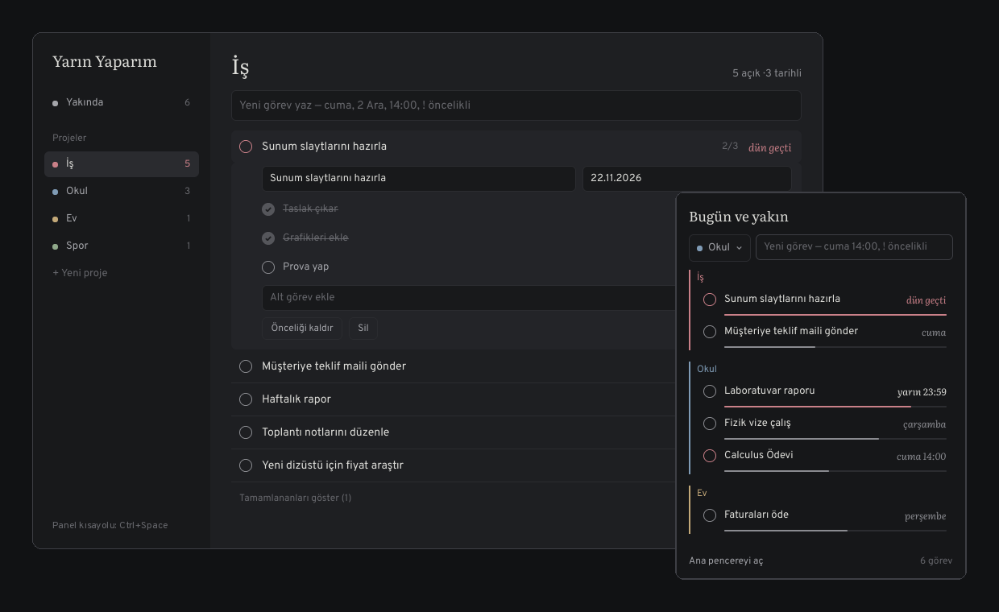
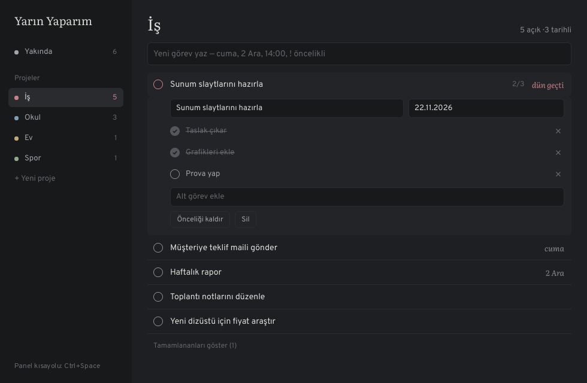
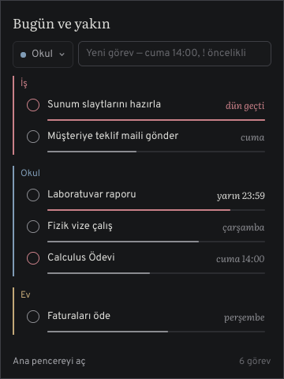

# Yarın Yaparım

Projeler için hafif, koyu temalı bir masaüstü yapılacaklar listesi. Rust + [Slint](https://slint.dev) ile yazıldı; Windows ve Linux'ta tray'de yaşar.



## Özellikler
- Projeler (renkli), görevler, alt görevler, öncelik, sürükle-bırak sıralama
- Deadline'lı veya deadline'sız görev; Türkçe hızlı giriş:
  `Calculus Ödevi cuma 14:00 ! #Okul` → başlık, tarih, saat, öncelik, proje
  (bugün, yarın, öbür gün, haftaya, pzt…paz, `2 Ara`, `25.11`, `+3`, `3 gün sonra`, `14:00`)
- "Yakında" görünümü: tüm projelerdeki tarihli işler
- Kapat (X) → tray'e gizlenir; tray sağ tık → Ana pencere / Windows ile başlat / Çık
- Deadline bildirimleri: 24 saat kala ve zamanı gelince (yalnız tarihli görevlerde 09:00)
- Tray paneli: sol tık veya **Ctrl+Space** (sol alttaki "Panel kısayolu" yazısına tıklayıp değiştirilebilir) → geciken ve 7 gün içindeki işler, proje seçerek hızlı ekleme
- Tek örnek; Windows açılışında gizli başlar (`--hidden`)
- Veriler: Windows'ta `%APPDATA%\YarinYaparim\veri.db`, Linux'ta `~/.local/share/YarinYaparim/veri.db` (SQLite)

## Ekranlar
| Ana pencere | Tray paneli (Ctrl+Space) |
|---|---|
|  |  |

Ana pencerede bir göreve tıklayınca açılır: başlık, deadline, alt görevler, öncelik. Panelde geciken ve 7 gün içindeki işler proje proje görünür; alttaki çizgi deadline yaklaştıkça dolar.

## Derleme (Windows)
```
rustup default stable
cargo build --release
```
Çıktı: `target\release\YarinYaparim.exe`

Linux'tan Windows'a çapraz derleme MinGW ile yapılabilir (`x86_64-pc-windows-gnu`).

## Linux
```
sudo apt install build-essential libfontconfig-dev libxkbcommon-dev   # Debian/Ubuntu
cargo build --release
./target/release/YarinYaparim
```
- Tray: StatusNotifierItem (KDE, XFCE, Cinnamon doğrudan; GNOME'da "AppIndicator and KStatusNotifierItem Support" eklentisi gerekir). Tray bulunamazsa X ile uygulama kapanır.
- Ctrl+Space yalnız X11'de çalışır. Wayland'de sistem ayarlarından bir kısayola `YarinYaparim --panel` komutunu bağla.
- Oturumla başlatma: `~/.config/autostart/yarinyaparim.desktop`
- Komutlar: `--hidden` (gizli başla), `--panel` (paneli aç; uygulama açıksa ona iletir)

## Yapı
- `src/main.rs` – uygulama mantığı, pencereler, tray olayları
- `src/db.rs` – SQLite şeması ve sorgular
- `src/parse.rs` – Türkçe tarih/saat ayrıştırıcı (`cargo test`)
- `src/platform.rs` – Windows ve Linux: tray, kısayol, otomatik başlatma, tek örnek
- `ui/app.slint` – arayüz (ana pencere + tray paneli)

## Yol haritası
- [x] Ana pencere, projeler, görevler
- [x] Tray, otomatik başlatma, tray paneli, kısayol
- [x] Deadline bildirimleri
- [x] Değiştirilebilir panel kısayolu
- [x] MCP sunucusu (Claude'un görev ekleyebilmesi için)

## MCP kurulumu (Claude'un görev ekleyebilmesi)
Aynı exe `--mcp` bayrağıyla stdio MCP sunucusu olarak çalışır ve uygulamayla aynı veritabanını kullanır. Uygulama açıksa değişiklikler ~1 saniye içinde ekrana yansır.

**Claude Desktop** — `claude_desktop_config.json` dosyasına ekle
(Windows: `%APPDATA%\Claude\claude_desktop_config.json`, Linux: `~/.config/Claude/claude_desktop_config.json`):
```json
{
  "mcpServers": {
    "yarin-yaparim": {
      "command": "C:\\Users\\KULLANICI\\Downloads\\YarınYaparım\\Yarın Yaparım.exe",
      "args": ["--mcp"]
    }
  }
}
```
Linux'ta `command` için `/home/KULLANICI/.../YarinYaparim` yolunu yaz. Kaydettikten sonra Claude Desktop'ı tamamen kapatıp yeniden aç.

**Claude Code**:
```
claude mcp add yarin-yaparim -- "C:\Users\KULLANICI\Downloads\YarınYaparım\Yarın Yaparım.exe" --mcp
```

**Araçlar**: `list_projects`, `add_project`, `list_tasks` (proje / tarih aralığı / yalnız açık), `add_task` (başlık, proje, deadline, öncelik, üst görev; Türkçe tarih ifadesi kabul eder: "cuma 14:00"), `update_task`, `complete_task`, `delete_task`.

Görevler `id` ile anılır; Claude önce `list_tasks` ile id'leri görür.

Örnek: *"Calculus ödevini Okul projesine cuma 14:00 deadline'la öncelikli ekle"* → Claude `add_task` çağırır, görev uygulamada belirir.

## Lisanslar
Fontlar (Overpass, Literata) SIL Open Font License 1.1 ile dağıtılır; bkz. `ui/fonts/*-OFL.txt`.
